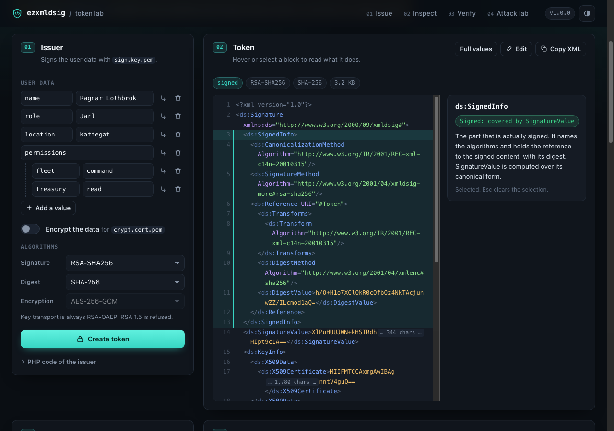
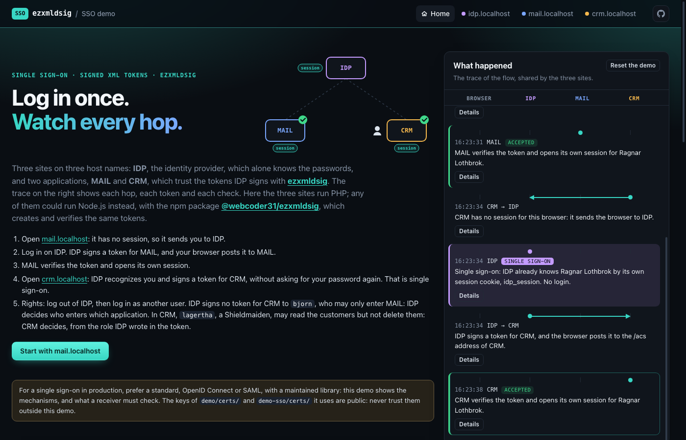

# EZXMLDSIG: Signed and encrypted XML tokens for PHP

Built on the library **xmlseclibs** developed by Rob Richards (https://github.com/robrichards/xmlseclibs), the library **ezxmldsig** creates and verifies XML tokens: enveloping XML digital signatures that carry timestamped user data (a PHP associative array), optionally encrypted. Use them for token based authentication, Single Sign On, or to transmit data whose integrity and origin, and confidentiality when they are encrypted, are protected by the token itself.

The library signs its own tokens only. It does not sign existing XML documents in place, parts of them, or external files: for these, use **xmlseclibs** directly, or a format designed for document signatures such as XAdES or PAdES.

The author of the **ezxmldsig** library is Thierry Thiers.


## Contents

* [Requirements](#requirements)
* [How to Install?](#how-to-install)
* [What's in the box?](#whats-in-the-box)
    * [XMLDSigToken class](#xmldsigtoken-class)
    * [X509Cert class](#x509cert-class)
* [How to use?](#how-to-use)
    * [Creating a signed XML token](#xmldsigtoken-creating-a-signed-xml-token)
    * [Creating a signed XML token with encrypted user data](#xmldsigtoken-creating-a-signed-xml-token-with-encrypted-user-data)
    * [Checking an XML token](#xmldsigtoken-checking-an-xml-token)
    * [Replay](#replay)
    * [Audience and expiry](#audience-and-expiry)
    * [XML parsing](#xml-parsing)
    * [Trust anchor](#trust-anchor)
    * [Encryption](#encryption)
    * [Certificates and keys](#certificates-and-keys)
    * [Options](#options)
    * [Upgrading from 0.x](#upgrading-from-0x)
* [Demo](#demo)
* [Single sign-on demo](#single-sign-on-demo)
* [Tests](#tests)
* [Documentation](#documentation)
* [Security](#security)
* [How to Contribute?](#how-to-contribute)


## Requirements

The library **ezxmldsig** requires PHP version 7.4 or greater, with the OpenSSL extension, and the library **xmlseclibs** developed by Rob Richards, version ^3.1.5 (3.1.5 or a later 3.x version).

The [demo](#demo), the [single sign-on demo](#single-sign-on-demo) and the [tests](#tests) are not part of the Composer package and have their own requirements (a running Docker daemon).


## How to Install?

The library **ezxmldsig** is available on [Packagist](https://packagist.org/packages/webcoder31/ezxmldsig) and you can install it for your project with [`composer.phar`](http://getcomposer.org).


```sh
php composer.phar require "webcoder31/ezxmldsig"
```

To stay on the 1.x versions (no backward-incompatible change), pin the major version:

```sh
php composer.phar require "webcoder31/ezxmldsig:^1.0"
```

You can also clone it (or download it as a ZIP archive) from its [GitHub repository](https://github.com/webcoder31/ezxmldsig.git) and load it the way you want in your project. In this case, you will have to do the same from the [**xmlseclibs** GitHub repository](https://github.com/robrichards/xmlseclibs) of Rob Richards.


## What's in the box?

### XMLDSigToken class

The ``XMLDSigToken`` class allows creating and analyzing enveloping XML Digital Signature containing timestamped user data that may also be encrypted, also called XML token. With such tokens, you may create your own Single Sign On solution. You can secure access to your Web Services, as with JSON Web Token. You can transmit data whose integrity and origin, and also confidentiality when they are encrypted, are protected by the token itself, whatever the connection that carries it. Or anything you can think of that requires such kind of features.

The token protects its own content only: not the request that carries it (URL, headers, other fields), nor the response, nor the identity of the server it is sent to. Use an HTTPS connection for these.

**The ``XMLDSigToken`` class offers the following features:**

1) It builds an XML token from a flat or multidimensional associative array representing the user data and retrieves it in the same way.

2) It allows choosing the various algorithms that should be used to build the XML Digital Signature (see [Options](#options)). The ones used by default are the following:
    * Algorithm used to canonicalize data before signing is: http://www.w3.org/TR/2001/REC-xml-c14n-20010315.
    * Algorithm used to generate the signature is: http://www.w3.org/2001/04/xmldsig-more#rsa-sha256.
    * Algorithm used to compute the hash of contained data is: http://www.w3.org/2001/04/xmlenc#sha256.
    * Algorithm used to encode user data values is: Base64.

3) It is also capable of encrypting / decrypting token data, so that only the recipient can read them, even when the token travels over an unencrypted HTTP connection. Only the token data are encrypted: unlike an SSL/TLS connection, this protects neither the rest of the request nor the response, does not authenticate the server, and does not prevent an intercepted token from being submitted again (see [Replay](#replay)).
The class allows choosing the algorithms that should be used to perform data encryption. By default it uses the following ones:
    * Algorithm used to encrypt data is: http://www.w3.org/2009/xmlenc11#aes256-gcm (authenticated symmetric ciphering).
    * Algorithm used to encrypt the session key that will be used to encrypt data is: http://www.w3.org/2001/04/xmlenc#rsa-oaep-mgf1p (asymmetric ciphering).

4) It guarantees the integrity and the origin of the user data stored in the XMLDSig token by verifying that:
    * The XML digital signature has the structure of an XML token: an enveloping signature whose single reference covers the token it holds. The library checks the elements of this fixed structure, not every rule of the XMLDSIG specification.
    * The algorithms used to construct the XML digital signature are those expected.
    * The token contained in the XML digital signature has not been altered.
    * The X.509 certificate included in the XML digital signature is trusted: it is valid at the current date, OpenSSL verifies its chain up to the CA certificates you trust and/or it is the very certificate you pinned, and its subject is the one you expect, if you ask for it (see [Trust anchor](#trust-anchor)).

5) It is also able to verify with confidence that the token is not out of date because the token timestamp is signed too. Each token also holds a signed random identifier, which lets the receiver refuse a token it has already accepted (see [Replay](#replay)). These two checks are up to the receiver: ``isSignatureValid()`` makes neither (see [Checking an XML token](#xmldsigtoken-checking-an-xml-token)).

6) It gives access to the information of the X.509 certificate included in the XML Digital Signature (subject, issuer, validity dates), and keeps individual checks on it:
    * Ensure that the certificate is not out of date.
    * Check the issuer names of the certificate.
    * Verify that the certificate was issued by a given CA certificate.

7) It refuses, before parsing them, the XML documents that have a document type declaration (see [XML parsing](#xml-parsing)), and its HTML output (``getHTMLDump()``) escapes every value it shows and loads no external resource.


### X509Cert class

The ``X509Cert`` class provides a set of convenient methods for extracting essential information contained in an X.509 certificate and for performing some useful checks, all of them with OpenSSL: whether the certificate was issued by a given CA certificate (``isValidCA()``), whether OpenSSL verifies its chain up to trusted CA certificates (``isTrustedBy()``), whether its key usage allows signing (``canSign()``). This class is used internally by the ``XMLDSigToken`` class.


## How to use?

**NOTE:** The library **ezxmldsig** is designed to work with cryptographic material in PEM format.

To see it work before writing any code, open the [demo](#demo) online (https://ezxmldsig.wbcdr.dev/) or run it on your machine (`bin/demo`): it creates, explains and verifies tokens, and replays the attacks the library refuses.


### XMLDSigToken: Creating a signed XML token

The example below shows basic usage of the ``XMLDSigToken`` class for creating a signed token enveloped in an XML Digital Signature.

To do so, the ``XMLDSigToken`` class requires an asymmetric cryptographic key pair:
* A private key the class will use to sign the token.
* The password that allows reading the private key (Optional - Depends on how the private key was created).
* The X.509 certificate related to the private key that will be included within the XML Digital Signature in order to allow the recipient to verify the token integrity.


#### Source code

```php
// Load required classes manually.
// require(dirname(__DIR__) . '/vendor/robrichards/xmlseclibs/xmlseclibs.php');
// require(dirname(__DIR__) . '/ezxmldsig.php');

// Autoload required classes.
require dirname(__DIR__) . '/vendor/autoload.php';

// Use statements.
use webcoder31\ezxmldsig\XMLDSigToken;

// Asymmetric cryptographic key pair for signing (in PEM format).
$signKey = 'path/to/signing/private/key';
$signCert = 'path/to/signing/public/certificate';
$signKeyPassword = 'signing-key-password'; // Use null if it is not needed.

// User data.
$data = [
    'name' => 'Ragnar Lothbrok',
    'role' => 'Jarl',
    'location' => 'Kattegat'
];

// Create token for user data.
$token = XMLDSigToken::createXMLToken($data, $signKey, $signCert, $signKeyPassword);

// Get the XML Digital Signature.
$sig = $token->getXML();

// Display the XML Digital Signature.
echo htmlentities($sig);
```

#### Result

The result below was produced by this code with the certificates of `demo/certs/`, then indented and its long Base64 values shortened to their first and last 8 characters. The user data are Base64 encoded: ``UmFnbmFyIExvdGhicm9r`` is ``Ragnar Lothbrok``.

```xml
<?xml version="1.0"?>
<ds:Signature xmlns:ds="http://www.w3.org/2000/09/xmldsig#">
  <ds:SignedInfo>
    <ds:CanonicalizationMethod Algorithm="http://www.w3.org/TR/2001/REC-xml-c14n-20010315"/>
    <ds:SignatureMethod Algorithm="http://www.w3.org/2001/04/xmldsig-more#rsa-sha256"/>
    <ds:Reference URI="#Token">
      <ds:Transforms>
        <ds:Transform Algorithm="http://www.w3.org/TR/2001/REC-xml-c14n-20010315"/>
      </ds:Transforms>
      <ds:DigestMethod Algorithm="http://www.w3.org/2001/04/xmlenc#sha256"/>
      <ds:DigestValue>8TdHTRsJ ... FpKRsBk=</ds:DigestValue>
    </ds:Reference>
  </ds:SignedInfo>
  <ds:SignatureValue>ANXIS2CZ ... CF/GYw==</ds:SignatureValue>
  <ds:KeyInfo>
    <ds:X509Data>
      <ds:X509Certificate>MIIFMTCC ... tV4guQ==</ds:X509Certificate>
    </ds:X509Data>
  </ds:KeyInfo>
  <ds:Object Id="Token">
    <Token>
      <TokenTimestamp>2026-10-17T06:58:55Z</TokenTimestamp>
      <TokenId>9e0325fac353152dd7c241a719da0f72</TokenId>
      <TokenData>
        <name Algorithm="base64">UmFnbmFyIExvdGhicm9r</name>
        <role Algorithm="base64">SmFybA==</role>
        <location Algorithm="base64">S2F0dGVnYXQ=</location>
      </TokenData>
    </Token>
  </ds:Object>
</ds:Signature>
```

### XMLDSigToken: Creating a signed XML token with encrypted user data

The example below shows how to use the ``XMLDSigToken`` class for creating a signed token whose user data will be encrypted.

To do so, the ``XMLDSigToken`` class requires the encryption certificate of the recipient: an X.509 certificate whose public key will be used by the class to encrypt a session key that will be used to encrypt user data. Only the private key related to this certificate, which the recipient keeps, can decrypt the user data.

The sender does not need this private key: pass ``null`` in its place (the fourth parameter of ``createSecureXMLToken()``), as below. The created token is then checked right away up to its decryption: its structure, its algorithms, its digest, its signature and the trust in the signing certificate. ``isSignatureValid()`` and ``isDataEncrypted()`` return ``TRUE``, while ``getData()``, ``getTimestamp()``, ``getTokenId()``, ``getAudience()`` and ``getExpiry()`` return ``NULL``: they are inside the encrypted content, which is not decrypted.

When the sender does hold this private key (for instance, when it encrypts tokens for itself), it can pass it, with its password (or ``null``) as seventh parameter: the created token is then also decrypted and its content checked, and ``getData()``, ``getTimestamp()``, ``getTokenId()``, ``getAudience()`` and ``getExpiry()`` return what it holds.


#### Source code

```php
// Load required classes manually.
// require(dirname(__DIR__) . '/vendor/robrichards/xmlseclibs/xmlseclibs.php');
// require(dirname(__DIR__) . '/ezxmldsig.php');

// Autoload required classes.
require dirname(__DIR__) . '/vendor/autoload.php';

// Use statements.
use webcoder31\ezxmldsig\XMLDSigToken;

// Asymmetric cryptographic key pair for signing (in PEM format).
$signKey = 'path/to/signing/private/key';
$signCert = 'path/to/signing/public/certificate';
$signKeyPassword = 'signing-key-password'; // Use null if it is not needed.

// Encryption certificate of the recipient (in PEM format). Its private key
// stays with the recipient.
$cryptCert = 'path/to/encryption/public/certificate';

// User data.
$data = [
    'name' => 'Ragnar Lothbrok',
    'role' => 'Jarl',
    'location' => 'Kattegat'
];

// Create token for user data, without the private key of the recipient
// (null).
$token = XMLDSigToken::createSecureXMLToken($data, $signKey, $signCert, null, $cryptCert, $signKeyPassword);

// Get the XML Digital Signature.
$sig = $token->getXML();

// Display the XML Digital Signature.
echo htmlentities($sig);
```


#### Result

The result below was produced by this code with the certificates of `demo/certs/`, then indented and its long Base64 values shortened to their first and last 8 characters. The user data, the timestamp and the identifier of the token are in the last ``xenc:CipherValue``, encrypted.

```xml
<?xml version="1.0"?>
<ds:Signature xmlns:ds="http://www.w3.org/2000/09/xmldsig#">
  <ds:SignedInfo>
    <ds:CanonicalizationMethod Algorithm="http://www.w3.org/TR/2001/REC-xml-c14n-20010315"/>
    <ds:SignatureMethod Algorithm="http://www.w3.org/2001/04/xmldsig-more#rsa-sha256"/>
    <ds:Reference URI="#Token">
      <ds:Transforms>
        <ds:Transform Algorithm="http://www.w3.org/TR/2001/REC-xml-c14n-20010315"/>
      </ds:Transforms>
      <ds:DigestMethod Algorithm="http://www.w3.org/2001/04/xmlenc#sha256"/>
      <ds:DigestValue>IDS0UTTp ... 5wuPKks=</ds:DigestValue>
    </ds:Reference>
  </ds:SignedInfo>
  <ds:SignatureValue>Q65Aoros ... 1pKHUQ==</ds:SignatureValue>
  <ds:KeyInfo>
    <ds:X509Data>
      <ds:X509Certificate>MIIFMTCC ... tV4guQ==</ds:X509Certificate>
    </ds:X509Data>
  </ds:KeyInfo>
  <ds:Object Id="Token">
    <xenc:EncryptedData xmlns:xenc="http://www.w3.org/2001/04/xmlenc#" Type="http://www.w3.org/2001/04/xmlenc#Content">
      <xenc:EncryptionMethod Algorithm="http://www.w3.org/2009/xmlenc11#aes256-gcm"/>
      <ds:KeyInfo xmlns:dsig="http://www.w3.org/2000/09/xmldsig#">
        <xenc:EncryptedKey>
          <xenc:EncryptionMethod Algorithm="http://www.w3.org/2001/04/xmlenc#rsa-oaep-mgf1p"/>
          <xenc:CipherData>
            <xenc:CipherValue>T7VtnPzT ... LM83BA==</xenc:CipherValue>
          </xenc:CipherData>
        </xenc:EncryptedKey>
      </ds:KeyInfo>
      <xenc:CipherData>
        <xenc:CipherValue>cFU72/hC ... RC2xH8M=</xenc:CipherValue>
      </xenc:CipherData>
    </xenc:EncryptedData>
  </ds:Object>
</ds:Signature>
```


### XMLDSigToken: Checking an XML token

In the following example, we will assume that we will receive the XML digital signature (in a Base64 coded field of an HTTP POST request) from an approved source that we want to ensure is the issuer. We will extract the signature from the POST request and we will perform all the checks needed to make sure we can trust the received user data.

The analysis requires a trust anchor, described below: without it, no token is valid.

**``isSignatureValid()`` checks neither the freshness of the token nor whether it is replayed.** A token that was valid once stays valid for it, however old it is and however many times it is submitted. Before trusting the data of a received token, the receiver must make three checks, as the example below does:

1. ``isSignatureValid()`` returns ``TRUE``: structure, algorithms, digest, signature, trust in the signing certificate, and audience when the token names one (see [Audience and expiry](#audience-and-expiry));
2. ``isOutOfDate($ttl)`` returns ``FALSE``, for the time to live the application accepts, and the expiry of the token if it has one (freshness);
3. the identifier returned by ``getTokenId()`` has not been accepted before: store it atomically, and refuse the token if it already is (replay, see [Replay](#replay)).

**Restrict the trust anchor to the sender.** ``caCertPath`` accepts any certificate its CA issues. As soon as this CA also issues certificates to others than the expected sender (a public CA, or a company CA that issues one per server or per partner), any of them can sign a token that ``isSignatureValid()`` accepts: add ``expectedSubject`` (the subject of the certificate of the sender), or pin the certificate of the sender with ``signerCertPath`` (see [Trust anchor](#trust-anchor)).


#### Source code

```php
// Load required classes manually.
// require(dirname(__DIR__) . '/vendor/robrichards/xmlseclibs/xmlseclibs.php');
// require(dirname(__DIR__) . '/ezxmldsig.php');

// Autoload required classes.
require dirname(__DIR__) . '/vendor/autoload.php';

// Use statements.
use webcoder31\ezxmldsig\XMLDSigToken;

// Get the Base64 encoded XML Digital Signature and decode it.
if (!isset($_POST['xmltoken']))
{
    echo "Can't find XML token in HTTP POST request!";
    exit();
}
$sig = base64_decode($_POST['xmltoken']);

// Private key (and possibly its passphrase) to be used
// to decrypt token (required if user data is encrypted).
$cryptKey = 'path/to/decryption/private/key';
$cryptKeyPassword = 'decryption-key-password'; // Use null if it is not needed.

// Trust anchor (required): the CA that issued the signing certificate of the
// sender, and the certificates up to its root. The subject the signing
// certificate must have restricts it to the sender: the CA may also issue
// certificates to others.
$options = [
    'caCertPath' => [
        'path/to/ca/intermediate/certificate',
        'path/to/ca/root/certificate',
    ],
    'expectedSubject' => ['O' => 'Lothbrok Ltd', 'OU' => 'Signature Dept'],
];

// Create token object from the XML Digital Signature.
$token = XMLDSigToken::analyzeSecureXMLToken($sig, $cryptKey, $cryptKeyPassword, $options);

// NOTE: The above instruction works even if user data is not encrypted.
// However, if user data is not encrypted and you don't own a private key
// then use the following method:
// $token = XMLDSigToken::analyzeXMLToken($sig, $options);

// Check 1 of 3. Verify that:
// - the XML digital signature has the structure of an XML token.
// - the algorithms used to construct the XML digital signature are those
//   expected (here, the default ones).
// - the token contained in the XML digital signature has not been altered.
// - the signing certificate is valid at the current date, has been issued
//   by a trusted CA and has the expected subject.
// - the token contained in the XML digital signature is correctly timestamped
//   and contains user data.
// It checks neither the freshness of the token nor whether it is replayed:
// see the two checks that follow.
if (!$token->isSignatureValid())
{
    // The error may quote what the token holds: escape it.
    echo "ERROR: Invalid XML Digital Signature! " . htmlspecialchars($token->getError(), ENT_QUOTES | ENT_SUBSTITUTE, 'UTF-8');
    exit();
}

// Check 2 of 3: verify that the XML token was issued less than 2 minutes
// ago.
if ($token->isOutOfDate(120))
{
    echo "ERROR: Token is out of date!";
    exit();
}

// Check 3 of 3: refuse a token already accepted (see Replay below). apcu_add() only adds
// the identifier if it is not stored yet, and keeps it for as long as the
// token could be accepted: 120 seconds of validity plus the clock tolerance.
if (!apcu_add('xmltoken-' . $token->getTokenId(), true, 120 + XMLDSigToken::DESYNC_TOLERANCE))
{
    echo "ERROR: Token already used!";
    exit();
}

// All is fine! We can trust user data.
echo "Token data:";
echo '<pre>' . htmlspecialchars(print_r($token->getData(), true), ENT_QUOTES | ENT_SUBSTITUTE, 'UTF-8') . '</pre>';
```


### Replay

A valid token can be submitted again, by whoever intercepted it, for as long as ``isOutOfDate()`` accepts it. **The library keeps no list of the tokens it has analyzed**: refusing a token already accepted is up to the receiver.

Each token holds an identifier of 128 random bits (``random_bytes()``), written in hexadecimal in the node ``Token/TokenId`` and covered by the signature: altering it invalidates the token. ``getTokenId()`` returns it (32 hexadecimal characters) for a valid token only, and ``NULL`` otherwise. The receiver must:

* store the identifier of each token it accepts, atomically with the check that it is not stored yet (``apcu_add()``, a unique key in a database, ``SET NX`` in Redis...), in a store shared by all the servers that receive the tokens;
* refuse a token whose identifier is already stored;
* keep each identifier at least as long as the token can be accepted. ``isOutOfDate($ttl)`` accepts a token from ``XMLDSigToken::DESYNC_TOLERANCE`` seconds (30) before its timestamp to ``$ttl`` seconds after it: keep the identifier ``$ttl + XMLDSigToken::DESYNC_TOLERANCE`` seconds after accepting the token.

A token without identifier, as created by the 0.x versions, is rejected (``Token identifier is missing!``): the receiver could not tell it from a replayed one. So is a token whose identifier is not 32 lowercase hexadecimal characters (``Token identifier is malformed!``).


### Audience and expiry

Available since version 1.1.

A token signed by a trusted issuer is valid for **every** receiver that trusts this issuer: a token issued for one application is accepted by another one, unless the token says who it is addressed to. Two creation options, both covered by the signature, address this, with the matching checks at analysis.

**Audience.** The option ``audience`` (a string, or a list of strings) names the receivers the token is addressed to: application names, URLs, any value the issuer and each receiver agree on. Each receiver gives its own with ``expectedAudience``, and ``isSignatureValid()`` checks it:

| Token | ``expectedAudience`` given | ``expectedAudience`` not given |
|---|---|---|
| Names audiences | Valid only if one of them is ``expectedAudience`` (compared as is, case included) | **Rejected**: a receiver that does not say who it is cannot accept a token addressed to someone |
| Names no audience | **Rejected**: the receiver asked for a token addressed to it | Valid, as in 1.0 |

```php
// The issuer addresses the token to the application "crm"...
$token = XMLDSigToken::createXMLToken($data, $signKey, $signCert, $signKeyPassword, [
    'audience' => 'crm',
    'validity' => 60,
]);

// ...which accepts it, while the application "mail" rejects it.
$token = XMLDSigToken::analyzeXMLToken($sig, [
    'caCertPath' => ['path/to/ca/intermediate/certificate', 'path/to/ca/root/certificate'],
    'expectedAudience' => 'crm',
]);
```

A rejected token gives the reason in ``getError()``, e.g. ``Token is not addressed to the expected audience! Expected: 'mail'. Token audience: 'crm'.``, and its data are not read. ``getAudience()`` returns the audiences of a valid token, ``NULL`` otherwise. An audience is a non-empty string, without surrounding white space or control characters: an option that breaks these rules throws an exception.

**Expiry.** The option ``validity`` (a number of seconds) writes in the token the date after which it is out of date. ``isOutOfDate($ttl)`` then rejects the token once this date is passed, whatever ``$ttl``: the shorter of the validity set by the issuer and the time to live set by the receiver applies. Like the time to live, the expiry is a check left to the caller: ``isSignatureValid()`` does not make it. ``getExpiry()`` returns the expiry of a valid token (format ``YYYY-MM-DDThh:mm:ssZ``, UTC), ``NULL`` otherwise. A token whose expiry is malformed, repeated or not after its timestamp is not valid.

Keep the identifiers stored against replay (see [Replay](#replay)) as long as the time to live of the receiver requires: the expiry can only shorten it.

**Compatibility with 1.0.** The audiences are in the nodes ``Token/TokenAudience`` and the expiry in ``Token/TokenExpiry``. Version 1.0 ignores these nodes: **a receiver still in 1.0 accepts a token addressed to another receiver, and a token whose expiry is passed**, applying only its own time to live. Upgrade every receiver before relying on these options. Tokens without audience nor expiry, those of 1.0 included, are analyzed as before.


### XML parsing

A document type declaration (``<!DOCTYPE ...>``) declares entities, which the XML parser expands where the document references them: nested entities make a small document grow to gigabytes, and external entities read local files or URLs. A token never has one: the analysis, like ``XMLDSigToken::alterXML()``, refuses any document holding ``<!DOCTYPE`` before parsing it (``XML Digital Signature must not have a document type declaration (DOCTYPE)!``).

This check reads the bytes of the document, which only show ``<!DOCTYPE`` as is in UTF-8, the encoding of the tokens. A document in another encoding is therefore refused too (``XML Digital Signature must be encoded in UTF-8!``): one that holds a NUL byte (UTF-16, UTF-32) or declares another encoding. The documents are parsed with ``LIBXML_NONET`` (no network access), and any XML error rejects them, without PHP warning.


### Trust anchor

The signature of a token is verified with the X.509 certificate the token carries. Anyone can sign a token with a key pair of their own and a certificate that copies the names (subject, issuer) of a legitimate one: the signature alone proves nothing. The analysis therefore requires a trust anchor, given in its ``$options``, and ``isSignatureValid()`` only returns ``TRUE`` if the certificate of the token is trusted:

* **``caCertPath``** (string or array of strings): PEM files holding the CA certificates you trust. OpenSSL must build and verify the chain of the signing certificate up to a self-signed certificate of these files: signature of each link, validity dates, CA constraints and key usage of each issuer.
* **``signerCertPath``** (string): a PEM certificate the token must be signed with (pinning). Given alone, it is the trust anchor; given with ``caCertPath``, both are required.
* **``expectedSubject``** (array or string, optional): the subject the signing certificate must have. Character case is significant. It does not replace ``caCertPath`` or ``signerCertPath``. **Give it, or ``signerCertPath``, whenever the CA of ``caCertPath`` also issues certificates to others than the expected sender**: without it, any certificate of this CA is accepted.
    * As an array, the fields to check, as returned by ``getCertSubject()``: ``['O' => 'Lothbrok Ltd', 'OU' => 'Signature Dept']``. Fields that are not given are not checked.
    * As a string, the full Distinguished Name, compared as is with the one ``getCertDN()`` returns. This is the OpenSSL "oneline" format: every field of the subject, in the order of the certificate, each written ``/<short name>=<value>`` with no space and no escaping:

      ```
      /C=DK/ST=Jylland/L=Kattegat/O=Lothbrok Ltd/OU=Signature Dept/CN=www.lothbrok.dk/emailAddress=ivar@lothbrok.dk
      ```

      It is neither the RFC 2253 form (``CN=...,O=...``) nor the form printed by the ``openssl`` command line (``C=DK, ST=...``): copy it from ``getCertDN()``.

In every case, the signing certificate must be valid at the current date and, if it has a ``keyUsage`` extension, allow ``digitalSignature`` or ``nonRepudiation``.

**Trusting an intermediate CA.** OpenSSL only accepts a chain that ends at a self-signed root. To trust the certificates issued by an intermediate CA, give its certificate **and** the certificates up to its root, as several files or as one file holding them all:

```php
$options = ['caCertPath' => ['path/to/intermediate.cert.pem', 'path/to/root.cert.pem']];
```

With the intermediate certificate alone, every token is rejected and ``getError()`` returns:

```
Signing certificate is not issued by a trusted CA: its chain could not be verified up to the CA certificates of the option 'caCertPath', which must hold the issuing CA and the certificates up to its root!
```

Only the signing certificate is taken from the token, never intermediate certificates: a certificate issued by another intermediate CA of the same root is rejected, since its issuer is not in your files. A certificate issued directly by one of the CA certificates you give (the root included) is accepted: add ``expectedSubject`` to narrow it down to the sender.

**Without a trust anchor**, ``isSignatureValid()`` returns ``FALSE`` and ``getError()`` returns ``No trust anchor! Pass the option 'caCertPath' (trusted CA certificates) and/or 'signerCertPath' (pinned signing certificate) to analyze a token: without them, no signing certificate can be trusted.``. An option of the wrong type, or naming a file that cannot be read, throws an exception.

``isCertTrusted()`` tells whether the certificate passed these checks. The individual checks ``isCertOutOfDate()``, ``isValidCertIssuer()`` and ``isValidCertCA()`` remain available, but ``isSignatureValid()`` does not need them. ``isValidCertIssuer()`` only compares names, which any certificate can copy.

When a token is created, it is analyzed right away to check it, with the certificate of its own signing key as trust anchor. An encrypted token created without the private key of the recipient is checked up to its decryption (see [Encryption](#encryption)).


### Encryption

The token data are encrypted with a session key generated for each token, and the session key is encrypted for the recipient with the encryption certificate (key transport). The encryption takes place before the signature, which therefore covers the encrypted data.

* **The sender needs no private key of the recipient.** ``createSecureXMLToken()`` takes the private key of the recipient (``$cryptKeyPath``) only to decrypt the created token and check its content: pass ``null`` instead, and the created token is checked up to its decryption (structure, algorithms, digest, signature, trust in the signing certificate), its content left unread (``getData()``, ``getTimestamp()``, ``getTokenId()``, ``getAudience()`` and ``getExpiry()`` return ``NULL``). A password (``$cryptKeyPassword``) given without this key throws an exception.

* **Default algorithms.** The data are encrypted with AES-256-GCM (``AES256_GCM``) and the session key with RSA-OAEP (``RSA_OAEP_MGF1P``, http://www.w3.org/2001/04/xmlenc#rsa-oaep-mgf1p). AES-GCM checks an authentication tag before returning any data: altered data are rejected as a whole. A 256-bit key costs no more than a 128-bit one for data of this size.
* **Decryption after verification.** A token is only decrypted once its digest, its signature, the trust in its certificate (see [Trust anchor](#trust-anchor)) and its algorithms have been verified. A token that fails one of these checks is never decrypted.
* **One error for every decryption failure.** Whatever fails once the decryption starts (session key, data, parsing of the decrypted XML), ``getError()`` returns ``Token decryption failed!``, with no reason, no anomaly and no PHP warning. A distinct message per failure would let someone who can submit altered tokens tell which step failed, which is what padding oracle attacks need. Failures that do not depend on the encrypted content keep their own message (no decryption key, a key that cannot be loaded, a malformed ``xenc:EncryptedData``).
* **RSA 1.5 is refused.** The key transport algorithm http://www.w3.org/2001/04/xmlenc#rsa-1_5 (PKCS #1 v1.5 padding) is accepted neither at creation nor at analysis, and no option allows it: whether the padding of a submitted session key is valid can be told from its decryption (Bleichenbacher's attack), depending on the OpenSSL version PHP is built with. ezxmldsig always used RSA-OAEP by default; tokens created with RSA 1.5 on purpose must be created again with RSA-OAEP.
* **CBC is accepted only when declared.** AES-CBC and Triple DES CBC (``AES128_CBC``, ``AES192_CBC``, ``AES256_CBC``, ``TRIPLEDES_CBC``) have no integrity: altered data are decrypted all the same, and how the decrypted content fails can tell what the data hold (Jager and Somorovsky's attack on XML Encryption). Only the signature protects them, so that the decryption is the only obstacle left to a signer you trust who can submit altered tokens. An analysis decrypts a CBC token only if its option ``sessionKeyCipheringAlgorithm`` names this very algorithm, even when ``checkCryptingAlgorithms`` is ``FALSE``. Declare it only to read tokens of peers that cannot use AES-GCM yet:

  ```php
  $options = [
      'caCertPath' => ['path/to/ca/intermediate/certificate', 'path/to/ca/root/certificate'],
      'sessionKeyCipheringAlgorithm' => XMLDSigToken::AES128_CBC,
  ];
  $token = XMLDSigToken::analyzeSecureXMLToken($sig, $cryptKey, $cryptKeyPassword, $options);
  ```


### Certificates and keys

A token involves up to three kinds of certificates, all X.509 certificates in PEM format with **RSA keys**: the signature algorithms are RSA ones and the session key is encrypted with RSA-OAEP, so EC and DSA keys are not supported.

| Certificate | Who holds the private key | Who needs the certificate | Required |
|---|---|---|---|
| Signing certificate | The sender, to sign | The sender (it is copied into each token); the recipient when it pins it (``signerCertPath``) | Always |
| CA certificates | The CA that issues the signing certificate | The recipient (``caCertPath``) | Unless the signing certificate is pinned |
| Encryption certificate | The recipient, to decrypt | The sender, to encrypt | For encrypted tokens only |

**What the library checks.** The signing certificate must be valid at the current date and, if it has a ``keyUsage`` extension, allow ``digitalSignature`` or ``nonRepudiation``. With ``caCertPath``, OpenSSL also checks every certificate of the chain: validity dates, signature, and, for each issuer, ``basicConstraints`` with ``CA:TRUE`` and a ``keyUsage`` that allows ``keyCertSign`` (see [Trust anchor](#trust-anchor)). The encryption certificate is not checked: give it a ``keyUsage`` that allows ``keyEncipherment`` all the same. Use keys of 2048 bits at least; the library does not enforce a size.

**The subject fields.** The subject of a certificate is a Distinguished Name made of fields. The library requires none of them, but the recipient can only tell the expected sender from the other holders of certificates of the same CA by these fields, with ``expectedSubject``:

| Field | Name | Usual content |
|---|---|---|
| ``C`` | Country | Two-letter country code (``DK``) |
| ``ST`` | State or province | Region (``Jylland``) |
| ``L`` | Locality | City (``Kattegat``) |
| ``O`` | Organization | Legal name of the organization (``Lothbrok Ltd``) |
| ``OU`` | Organizational unit | Department or service within the organization (``Signature Dept``) |
| ``CN`` | Common name | Name of the certificate holder: a person, a service or a host name (``www.lothbrok.dk``) |
| ``emailAddress`` | Email address | Contact address (``ivar@lothbrok.dk``) |

``O`` and ``OU`` are the fields the recipient usually checks: ``['O' => 'Lothbrok Ltd', 'OU' => 'Signature Dept']`` accepts the certificates of this department of this organization, and those only. Give each sender a subject that sets it apart from the other holders of certificates of the same CA (a distinct ``OU`` or ``CN``), and use the same values, character case included, in the certificate and in ``expectedSubject``. A field repeated in the subject (two ``OU``, for instance) is an array of its values in ``getCertSubject()``.

**Creating them with OpenSSL.** The commands below create a root CA, an intermediate CA issued by the root, a signing certificate and an encryption certificate issued by the intermediate CA, valid for 2 years. Adapt the subjects and the durations, and keep the private keys out of any repository. The extensions go into a file, here ``ext.cnf``:

```ini
[root]
basicConstraints = critical, CA:TRUE
keyUsage = critical, keyCertSign, cRLSign
subjectKeyIdentifier = hash

[intermediate]
basicConstraints = critical, CA:TRUE, pathlen:0
keyUsage = critical, keyCertSign, cRLSign
subjectKeyIdentifier = hash
authorityKeyIdentifier = keyid

[sign]
basicConstraints = CA:FALSE
keyUsage = critical, digitalSignature, nonRepudiation
subjectKeyIdentifier = hash
authorityKeyIdentifier = keyid

[crypt]
basicConstraints = CA:FALSE
keyUsage = critical, keyEncipherment, dataEncipherment
subjectKeyIdentifier = hash
authorityKeyIdentifier = keyid
```

```sh
# Root CA: a self-signed certificate.
openssl genpkey -algorithm RSA -pkeyopt rsa_keygen_bits:4096 -out root.key.pem
openssl req -new -x509 -sha256 -days 730 -key root.key.pem \
    -subj "/C=DK/O=Lothbrok Ltd/CN=Lothbrok Root CA" \
    -config ext.cnf -extensions root -out root.cert.pem

# Intermediate CA, issued by the root.
openssl genpkey -algorithm RSA -pkeyopt rsa_keygen_bits:4096 -out intermediate.key.pem
openssl req -new -key intermediate.key.pem \
    -subj "/C=DK/O=Lothbrok Ltd/CN=Lothbrok Intermediate CA" -out intermediate.csr
openssl x509 -req -in intermediate.csr -sha256 -days 730 \
    -CA root.cert.pem -CAkey root.key.pem -CAcreateserial \
    -extfile ext.cnf -extensions intermediate -out intermediate.cert.pem

# Signing certificate of the sender, with a key protected by a password
# (the $signKeyPassword argument of the library).
openssl genpkey -algorithm RSA -pkeyopt rsa_keygen_bits:2048 \
    -aes-256-cbc -pass pass:signKeyPassword -out sign.key.pem
openssl req -new -key sign.key.pem -passin pass:signKeyPassword \
    -subj "/C=DK/O=Lothbrok Ltd/OU=Signature Dept/CN=www.lothbrok.dk" -out sign.csr
openssl x509 -req -in sign.csr -sha256 -days 730 \
    -CA intermediate.cert.pem -CAkey intermediate.key.pem -CAcreateserial \
    -extfile ext.cnf -extensions sign -out sign.cert.pem

# Encryption certificate of the recipient.
openssl genpkey -algorithm RSA -pkeyopt rsa_keygen_bits:2048 \
    -aes-256-cbc -pass pass:cryptKeyPassword -out crypt.key.pem
openssl req -new -key crypt.key.pem -passin pass:cryptKeyPassword \
    -subj "/C=DK/O=Lothbrok Ltd/OU=Cryptography Dept/CN=www.lothbrok.dk" -out crypt.csr
openssl x509 -req -in crypt.csr -sha256 -days 730 \
    -CA intermediate.cert.pem -CAkey intermediate.key.pem -CAcreateserial \
    -extfile ext.cnf -extensions crypt -out crypt.cert.pem

# Check the chains.
openssl verify -CAfile root.cert.pem -untrusted intermediate.cert.pem sign.cert.pem crypt.cert.pem
```

The recipient then trusts the sender with ``'caCertPath' => ['intermediate.cert.pem', 'root.cert.pem']`` and ``'expectedSubject' => ['O' => 'Lothbrok Ltd', 'OU' => 'Signature Dept']``. Without a CA, a self-signed signing certificate pinned by the recipient (``signerCertPath``) is enough: create it like the root above, with the extensions of ``[sign]``. ``bin/gen-test-certs`` creates the certificates of the tests and of the demo the same way.


### Options

Each factory takes an associative array ``$options`` as its last parameter. Each option applies to a context: token creation (``createXMLToken()``, ``createSecureXMLToken()``), token analysis (``analyzeXMLToken()``, ``analyzeSecureXMLToken()``) or both. The encryption options only apply when an encryption certificate (``createSecureXMLToken()``) or a decryption key (``analyzeSecureXMLToken()``) is given. An unknown option (a misspelt name, for instance), an option given out of its context, or an option whose value is ``NULL`` or invalid throws an exception: none is ignored.

| Option | Context | Type | Default |
|---|---|---|---|
| ``base64Encode`` | creation | boolean | ``TRUE`` |
| ``xmldsigNsPrefix`` | creation | string (``''``: no prefix) | ``'ds'`` |
| ``canonicalizationAlgorithm`` | creation and analysis | string | ``C14N`` |
| ``signatureAlgorithm`` | creation and analysis | string | ``RSA_SHA256`` |
| ``digestAlgorithm`` | creation and analysis | string | ``SHA256`` |
| ``checkSigningAlgorithms`` | analysis | boolean | ``TRUE`` |
| ``caCertPath``, ``signerCertPath``, ``expectedSubject`` | analysis | see [Trust anchor](#trust-anchor) | none |
| ``audience`` | creation | string or list of strings, see [Audience and expiry](#audience-and-expiry) | none |
| ``validity`` | creation | integer (seconds), see [Audience and expiry](#audience-and-expiry) | none |
| ``expectedAudience`` | analysis | string, see [Audience and expiry](#audience-and-expiry) | none |
| ``sessionKeyCipheringAlgorithm`` | encryption: creation with an encryption certificate, analysis with a decryption key | string | ``AES256_GCM`` |
| ``cryptAlgorithm`` | encryption: creation with an encryption certificate, analysis with a decryption key | string | ``RSA_OAEP_MGF1P`` |
| ``checkCryptingAlgorithms`` | analysis with a decryption key | boolean | ``TRUE`` |

The algorithms are given with the constants of the ``XMLDSigToken`` class (e.g. ``XMLDSigToken::RSA_SHA512``), whose values are the URIs of the XMLDSIG and XML Encryption specifications. Each algorithm option only accepts the algorithms of its own list:

* ``canonicalizationAlgorithm``: ``C14N``, ``C14N_COMMENTS``, ``EXC_C14N``, ``EXC_C14N_COMMENTS``.
* ``signatureAlgorithm``: ``RSA_SHA1``, ``RSA_SHA256``, ``RSA_SHA384``, ``RSA_SHA512``.
* ``digestAlgorithm``: ``SHA1``, ``SHA256``, ``SHA384``, ``SHA512``, ``RIPEMD160``.
* ``sessionKeyCipheringAlgorithm`` (symmetric encryption of the token data): ``AES128_GCM``, ``AES192_GCM``, ``AES256_GCM``, and the algorithms without integrity ``TRIPLEDES_CBC``, ``AES128_CBC``, ``AES192_CBC``, ``AES256_CBC``, which an analysis only accepts when this option names them (see [Encryption](#encryption)).
* ``cryptAlgorithm`` (encryption of the session key with the encryption certificate, or key transport): ``RSA_OAEP_MGF1P``. RSA 1.5 is refused (see [Encryption](#encryption)).

Signature and key transport algorithms are both asymmetric, but a key transport algorithm is refused as a signature algorithm, and the reverse, whether given as an option or read from a token.

At creation, the algorithm options are the algorithms the token is built with. At analysis, they are the algorithms the token must have been built with: a token built with other algorithms is rejected, and ``getError()`` names them (``Unauthorized Signature algorithm! Expected: ..., Used: ...``). ``checkSigningAlgorithms`` (signature, digest, canonicalization) and ``checkCryptingAlgorithms`` (session key, key transport) set to ``FALSE`` turn this check off; an algorithm out of the lists above is rejected all the same, and so is an undeclared CBC algorithm.

```php
// Create a token signed with RSA-SHA512 and an SHA-512 digest...
$token = XMLDSigToken::createXMLToken($data, $signKey, $signCert, $signKeyPassword, [
    'signatureAlgorithm' => XMLDSigToken::RSA_SHA512,
    'digestAlgorithm' => XMLDSigToken::SHA512,
]);

// ...and analyze it, expecting these algorithms.
$token = XMLDSigToken::analyzeXMLToken($sig, [
    'caCertPath' => ['path/to/ca/intermediate/certificate', 'path/to/ca/root/certificate'],
    'signatureAlgorithm' => XMLDSigToken::RSA_SHA512,
    'digestAlgorithm' => XMLDSigToken::SHA512,
]);
```


### Upgrading from 0.x

* **Trust anchor.** ``analyzeXMLToken($xml)`` and ``analyzeSecureXMLToken($xml, $cryptKeyPath, $cryptKeyPassword)`` without a trust anchor now reject every token: pass ``caCertPath`` (and/or ``signerCertPath``) in their ``$options``. A call to ``isValidCertCA()`` with the intermediate CA, which used to be the way to check the origin of the certificate, becomes ``'caCertPath' => [intermediate, root]``.
* **Default algorithms.** Tokens are signed with RSA-SHA256 and an SHA-256 digest (RSA-SHA1 and SHA-1 before), and the analysis expects these algorithms by default. A token created with the 0.x defaults is rejected (``Unauthorized Signature algorithm! ...``) unless the analysis declares them:

  ```php
  $options = [
      'caCertPath' => ['path/to/ca/intermediate/certificate', 'path/to/ca/root/certificate'],
      'signatureAlgorithm' => XMLDSigToken::RSA_SHA1,
      'digestAlgorithm' => XMLDSigToken::SHA1,
  ];
  ```

  Conversely, a 0.x analysis that expects the 0.x defaults rejects the tokens of this version: upgrade the receiver first, or pass ``'signatureAlgorithm' => XMLDSigToken::RSA_SHA1`` and ``'digestAlgorithm' => XMLDSigToken::SHA1`` to the creation until it is upgraded.
* **Options of ``createXMLToken()``.** Its ``$options`` were ignored: they now apply. Check that the options you pass to it are the ones you want.
* **Option checks.** An unknown option, an option out of its context (``checkSigningAlgorithms``, ``checkCryptingAlgorithms`` or a trust option at creation, ``base64Encode`` or ``xmldsigNsPrefix`` at analysis, an encryption option without an encryption certificate or a decryption key), or an option whose value is ``NULL`` or of the wrong type now throws an exception instead of being ignored. Remove such options.
* **Algorithm lists.** ``signatureAlgorithm`` no longer accepts ``RSA_1_5`` and ``RSA_OAEP_MGF1P``, ``cryptAlgorithm`` no longer accepts the ``RSA_SHA*`` algorithms, and ``sessionKeyCipheringAlgorithm``, which used to refuse every encryption algorithm, now accepts them.
* **``createSecureXMLToken()``** throws an exception when ``$cryptCertPath`` is ``NULL``, instead of creating an unencrypted token.
* **Token identifier.** Each token holds a signed random identifier (``Token/TokenId``, see [Replay](#replay)). A token without identifier, as created by a 0.x version, is rejected (``Token identifier is missing!``), whatever the options: upgrade the senders together with the receivers. A token is valid for a few seconds or minutes (``isOutOfDate()``): no token created before the upgrade needs to be read after it. Receivers should refuse the identifiers they have already accepted.
* **XML parsing.** A document with a document type declaration (``<!DOCTYPE``), or not encoded in UTF-8, is rejected before it is parsed, and ``alterXML()`` returns ``FALSE`` for it without changing it (see [XML parsing](#xml-parsing)). The tokens created by the library are in UTF-8 and have none.
* **``getHTMLDump()``** escapes every value it shows and no longer loads the ``run_prettify.js`` script of Google Code Prettify from a CDN: the XML token is shown without syntax highlighting.
* **Encryption.**
    * The data are encrypted with AES-256-GCM (AES-128-CBC before), and the analysis rejects a token encrypted with CBC unless it declares the algorithm (see [Encryption](#encryption)).
    * A 0.x analysis rejects AES-GCM (``Session Key Ciphering algorithm is invalid!``): upgrade the receivers first, declaring ``'sessionKeyCipheringAlgorithm' => XMLDSigToken::AES128_CBC`` while the senders create tokens with the 0.x defaults, then upgrade the senders and remove the option.
    * With ``'checkCryptingAlgorithms' => false`` too, a receiver accepts both the declared CBC algorithm and AES-GCM during the transition.
    * A sender upgraded first can pass the same option to ``createSecureXMLToken()`` until its receivers are upgraded.
    * RSA 1.5 is refused and the constant ``XMLDSigToken::RSA_1_5`` is removed: use ``RSA_OAEP_MGF1P``, the default.
    * A decryption failure gives ``Token decryption failed!`` instead of ``Session key decryption failed! Reason: ...`` or ``Token data decryption failed! Reason: ...``.
    * The sender no longer needs the private key of the recipient: ``createSecureXMLToken()`` accepts ``null`` as ``$cryptKeyPath`` (see [Encryption](#encryption)). Calls that pass it keep working.


## Demo

An interactive demo is online at **https://ezxmldsig.wbcdr.dev/**: nothing to install, and each visitor has a replay memory of their own. It also runs on your machine, which requires a running Docker daemon (e.g. Docker Desktop, or Colima with the repository under your home directory); neither PHP nor Composer has to be installed locally.

```
git clone https://github.com/webcoder31/ezxmldsig.git
cd ezxmldsig
bin/demo          # http://127.0.0.1:8080/
bin/demo 9000     # another port (or DEMO_PORT=9000)
```

The script first brings `vendor/` in line with `composer.json` with `bin/deps` (as `bin/test` does, see [Tests](#tests)), runs the PHP built-in web server in the official `php:8.3-cli` image, publishes it on `127.0.0.1` only, and opens the page in the browser when it can (`DEMO_NO_BROWSER=1` skips it). Ctrl-C stops it.



Every token of the demo is created and analyzed by the library, in PHP; the page only displays them:

* **Issuer**: user data (nested values allowed), encryption on or off, the audiences the token is addressed to and its validity (by default, the receiver of the demo, `receiver`, and 300 seconds), and the signature, digest and encryption algorithms.
* **Token**: the XML token, highlighted, each block explained when you point at it or select it with the arrow keys: what it does, and whether the signature covers it. It can be copied, or edited by hand before it is verified. Below it, a collapsed section shows the PHP code of the issuer that created this token; it changes only when a token is created.
* **Receiver**: the trust anchor (`caCertPath`, `signerCertPath`, `expectedSubject`), its own audience (`expectedAudience`), the decryption key, the expected algorithms, the time to live and the replay protection. The verification is shown as a pipeline of checks: those of `isSignatureValid()` (structure, algorithms, digest, signature, trust in the certificate, decryption, content, audience), then the two checks left to the caller, freshness (`isOutOfDate()`, expiry included) and replay (`getTokenId()`, stored in a file of `demo/var/`, under a lock, one per visitor: a cookie names it). The PHP code of this receiver is shown.
* **Attack lab**: each attack alters the last token of the issuer (or a new one, when the last one does not suit the attack) on the server and submits it to the receiver, with a replay memory of its own: data tampering, signature wrapping, look-alike certificate, EC key substitution, replay, expired token, token addressed to another receiver, token past the expiry its issuer set, DOCTYPE with entities, altered ciphertext signed again by a trusted signer, certificate of an untrusted CA, and a script in the data. Each one shows what was changed (as a diff), the check that stops it, the exact message, and the security advisory of the 0.x versions it relates to. No vulnerable code runs: the lab shows what the current version does.

> **WARNING: the private keys of `demo/certs/` are public.** They are published with the source code of this library, with their passwords: anyone can sign tokens that the demo trusts, and decrypt the tokens it encrypts. Use them for the demo only, never in an application or on a server reachable by others, and never trust their CA certificates: generate your own keys and certificates (see `demo/certs/README.md`). The same goes for the keys of `tests/fixtures/certs/`, which only serve the tests.

The certificates of the demo (`demo/certs/`: a root CA, the intermediate CA that issued the signing and encryption certificates, these certificates with their keys, and the certificates of the attacks) are valid for 10 years from their generation. To issue new ones, run `bin/gen-test-certs --demo`.

To serve the demo online, `demo/Dockerfile` builds an image with Apache and PHP 8.3, which listens on port 8000 as user `www-data`, every request routed to `demo/public/index.php`, and `GET /health` answering `ok`. `DEMO_PUBLIC_HOST` names the host it answers on besides `127.0.0.1` and `localhost`, served over HTTPS by a proxy in front of it. Only `demo/var/`, `/var/run/apache2` and `/var/lock/apache2` need to be writable. Build it from the root of the repository:

```
docker build -f demo/Dockerfile -t ezxmldsig-demo .
docker run --rm -p 127.0.0.1:8000:8000 ezxmldsig-demo
```

The demo is not part of the Composer package: `.gitattributes` leaves `demo/`, `demo-sso/`, `tests/`, `docs/`, `bin/` and `.dockerignore` out of the archives Composer installs.


## Single sign-on demo

A second demo plays a single sign-on with ezxmldsig tokens, between three sites on three host names: **idp**, the identity provider, which alone knows the users and their passwords and signs the tokens, and two applications, **mail** and **crm**, which have no password and trust the tokens of idp. Same requirements as the [demo](#demo); browsers resolve `*.localhost` to the local machine.

```
git clone https://github.com/webcoder31/ezxmldsig.git
cd ezxmldsig
bin/demo-sso          # http://localhost:8090/
bin/demo-sso 9090     # another port (or DEMO_SSO_PORT=9090)
```

1. Open `http://mail.localhost:8090/`: mail has no session, so it sends the browser to idp.
2. Log in on idp (the demo accounts are shown). idp opens its own session, signs a token addressed to mail (`audience`), valid 60 seconds (`validity`), and the browser posts it to mail, in a form, as the HTTP-POST binding of SAML does.
3. mail verifies the token: the checks of the library (`isSignatureValid()`: signature, trust in the certificate of idp, audience), then its own (freshness, replay). It opens its own session.
4. Open `http://crm.localhost:8090/`: idp recognizes the user by its own session cookie and signs a token for crm, without asking for the password again. That is single sign-on.



The pages show what the library checks and what each application checks itself, the cookies of each site (each site has its own: a cookie is sent to the host that set it), and the trace of the flow: each hop between the browser, idp, mail and crm, with each token and each check.

The demo accounts show two kinds of rights. **Access to an application** is decided by idp, which signs no token for an application the user may not enter: `bjorn` may only enter mail. **What a user may do in an application** is decided by the application, from an attribute idp writes in the token: in crm, `ragnar`, a Jarl, may delete a customer, and `lagertha`, a Shieldmaiden, may only read them. An attribute in a token stays as it is until the token expires, and so does the session the application opened with it: a right withdrawn in idp only takes effect with the next token.

The home page (`http://localhost:8090/`) holds:

* **The protections of the live demo**, which turn off the code of idp or of the applications that stops an attack: the audience, the registered return address, the freshness, the replay memory. And an option: idp encrypts each token for its application, with the certificate of that application (`demo-sso/certs/`).
* **The attack lab**: each attack runs in a sandbox of its own, with a victim and an attacker, through the very code of the three sites. Four of them are stopped by a protection of idp or of the applications, which can be turned off for a run to see the attack succeed: a token for another application, a replayed token, an old token, a hijacked return address. Three are stopped by the library itself, and have no switch: a tampered token, a token of another identity provider, and an encrypted token presented to another application.

> **For a single sign-on in production, prefer a standard, OpenID Connect or SAML, with a maintained library.** This demo shows the mechanisms, and what a receiver must check. Logging out of an application leaves idp and the other application logged in: logging out of every site at once (single logout) is a separate mechanism, which the demo does not implement.

The private keys of `demo-sso/certs/` are public, like those of `demo/certs/` (see `demo-sso/certs/README.md`); to issue new ones, run `bin/gen-test-certs --demo-sso`. The sessions, the trace and the replay memories are kept in `demo-sso/var/` (ignored by git).

## Tests

The PHPUnit test suite runs in Docker, so neither PHP nor PHPUnit has to be installed locally. Requirements: a running Docker daemon (e.g. Docker Desktop, or Colima with the repository under your home directory), `curl` and a POSIX shell.

```
bin/test                        # PHP 7.4, then PHP 8.3
bin/test 8.3                    # one PHP version
bin/test 7.4 -- --filter Secure # arguments after -- go to PHPUnit
```

The script uses the official `php:<version>-cli` images. On first run, it downloads the PHPUnit 9.6 PHAR into `tests/.cache/` (checked against a pinned SHA-256).

Before running anything, it calls `bin/deps`, which brings `vendor/` in line with `composer.json` in the `composer:2` image. `composer.lock` is not versioned, so each copy of the repository has its own, which may predate `composer.json`. `bin/deps` checks it without network: when `composer.lock` is missing or `composer validate` reports that it no longer matches `composer.json`, it runs `composer update`; when `vendor/` is missing or holds other versions than `composer.lock`, it runs `composer install`; otherwise it runs nothing else. It says on the terminal what it runs and why. When Composer refuses a dependency because of a security advisory, `COMPOSER_NO_BLOCKING=1` in front of the command overrides the refusal, at your own risk.

Tests that need a feature the current environment lacks are skipped, and PHPUnit prints the reason.

The suite also runs each attack of the attack lab of the [demo](#demo) with the code of the demo, and checks that its API never returns a value of a token as markup (`tests/Demo*Test.php`).

The certificates used by the tests live in `tests/fixtures/certs/`: a root CA, an intermediate CA, signing and encryption certificates issued by the intermediate, and a certificate signed by its own key that copies the subject and issuer names of the signing certificate. Run `bin/gen-test-certs` to generate them again (it runs OpenSSL in the `alpine:3.22` Docker image, whatever OpenSSL the host has). The tests of the trust anchor also issue certificates on the fly (expired, issued by another intermediate CA, issued by a certificate that is not a CA) in a temporary directory removed after each test.


## Documentation

Online documentation is available here: [EZXMLDSIG Documentation](https://webcoder31.github.io/ezxmldsig/).

This site is published by GitHub Pages from the `docs/` directory of the branch `master` (home page: `docs/index.html`). Its pages are generated from the docblocks of `src/` by [ApiGen](https://github.com/ApiGen/ApiGen), in Docker: run `bin/gen-docs` after changing a docblock, and commit `docs/` with the code.

```
bin/gen-docs
```

The script runs the official `apigen/apigen` image, pinned by digest since ApiGen publishes no versioned image, and installs the dependencies with `composer install` when `vendor/` is missing (ApiGen also documents the classes of PHP and xmlseclibs the code refers to). ApiGen runs with the configuration of `bin/apigen/`, which keeps the blank lines and the indentation of the docblocks: ApiGen alone drops them, and with them the lists and code blocks of the docblocks. Docblocks are written in Markdown: a code example is a fenced code block (```` ```php ````, ```` ```xml ````), not a `<code>` tag. It replaces `docs/` as a whole, so that the pages of removed classes or methods do not remain, and refuses to do so if a generated file holds an absolute path. The pages load their style sheet and scripts from `docs/assets/` only: the site loads nothing from other servers.


## Security

To report a vulnerability, see [SECURITY.md](SECURITY.md): report it privately, not in a public issue. Only the 1.x versions are maintained; the 0.x versions must no longer be used.


## How to Contribute?

* [Open Issues](https://github.com/webcoder31/ezxmldsig/issues)
* [Open Pull Requests](https://github.com/webcoder31/ezxmldsig/pulls)
